<p align="center">
  
</p>

# Awesome Content Management Systems (CMS) 🚀✨

<p align="left">
  <a href="https://github.com/ishandutta2007/Awesome-Awesome-Awesome"></a><a href="https://discord.gg/jc4xtF58Ve"></a>
  <a href="https://awesome.re"></a>
  <a href="http://creativecommons.org/publicdomain/zero/1.0/"></a>
  <a href="https://github.com/ishandutta2007/Awesome-Content-Management-System-Cms/pulls"></a>
  <a href="https://github.com/ishandutta2007"></a>
</p>

> 📚 A curated, battle-tested directory of the best **Content Management Systems (CMS)**, modern **Headless CMS**, **Decoupled & API-first CMS**, and **Open-Source Publishing Platforms** for developers, publishers, and enterprises.

---

## 📑 Table of Contents

- [🌐 Overview](#-overview)
- [📈 Sector Overview & Market Dynamics](#-sector-overview--market-dynamics)
- [⚡ Quick Highlights & Architecture Breakdown](#-quick-highlights--architecture-breakdown)
- [☁️ SaaS & Hosted CMS Platforms](#️-saas--hosted-cms-platforms)
- [💻 Open-Source GitHub Projects](#-open-source-github-projects)
  - [🔌 Headless & API-First CMS](#-headless--api-first-cms)
  - [🏛️ Traditional & Full-Stack CMS](#️-traditional--full-stack-cms)
  - [⚡ Jamstack, Git-Based & Flat-File CMS](#-jamstack-git-based--flat-file-cms)
- [🏗️ Architectural Guidelines & Decision Matrix](#️-architectural-guidelines--decision-matrix)
- [🤝 How to Contribute](#-how-to-contribute)
- [🌟 Star History](#-star-history)
- [💖 Support & Sponsorship](#-support--sponsorship)
- [📜 Disclaimer](#-disclaimer)

---

## 🌐 Overview

A **Content Management System (CMS)** empowers businesses, engineering teams, and creators to create, organize, schedule, and distribute content seamlessly across the web, mobile applications, IoT devices, and smart displays. Modern architectures range from traditional all-in-one monoliths with integrated templating engines to composable **API-first headless CMSs** and Git-backed Jamstack tools.

---

## 📈 Sector Overview & Market Dynamics

The global Content Management System (CMS) market is estimated at **$33 billion to $54 billion in 2026**, expanding at a compound annual growth rate (CAGR) of approximately 7% to 14% toward an expected $77B+ by 2033.

The sector exhibits a **dual structure**: it is **moderately concentrated at the top tier** where a handful of traditional giants power the vast majority of the web (led by WordPress with ~40%+ market share alongside Adobe and Salesforce in the enterprise DXP segment), yet **highly fragmented across the modern headless, composable, and developer-oriented CMS niches**, where dozens of venture-backed SaaS and open-source alternatives compete for specialized developer mindshare and omnichannel workloads.

---

## ⚡ Quick Highlights & Architecture Breakdown

| Category 🎯 | Top SaaS Platforms ☁️ | Leading Open-Source Repos 💻 |
| :--- | :--- | :--- |
| **Headless / API-First** | Contentful, Sanity, Storyblok, Contentstack | Strapi, Payload CMS, Directus, KeystoneJS |
| **Traditional & Publishing** | WordPress VIP, Ghost Pro, Adobe Experience Manager | WordPress, Ghost, Drupal, Wagtail, Umbraco |
| **Visual & No-Code Web** | Webflow Enterprise, Salesforce Site.com | Concrete CMS, Publii |
| **Jamstack & Git-Based** | — | Hugo, Astro, Decap CMS, TinaCMS, Grav |

---

## ☁️ SaaS & Hosted CMS Platforms

The table below catalogs leading SaaS CMS platforms, sorted by **Company Size (Valuation / Revenue)** in descending order, with exact starting tier prices and explicit free tier or trial limitations:

| Platform 🚀 | Company Size (Valuation / Revenue) 🏢 | Pricing (Starting Paid Tier) 💳 | Free Tier / Trial Limits 🎁 | Key Strengths & Architecture 💡 |
| :--- | :--- | :--- | :--- | :--- |
| **[Salesforce Experience Cloud / Site.com](https://www.salesforce.com/)** | **~$280B Market Cap** (FY25 Revenue: $34.9B) | **$25/user/month** (Starter Suite entry plan) | **30-day free trial** with full access to Starter Suite CRM & CMS features; no permanent free plan | Built-in integration with Salesforce CRM, customer portals, partner communities, and service clouds |
| **[Adobe Experience Manager (AEM)](https://business.adobe.com/products/experience-manager/sites/aem-sites.html)** | **~$220B Market Cap** (FY24 Revenue: $21.5B) | **$20,833/month** ($250,000/year minimum enterprise contract) | **No free tier**; custom sandbox trial accessible only via Adobe enterprise sales engagement | Industry standard enterprise DXP with digital asset management, multi-site governance, and AI authoring |
| **[WordPress VIP](https://wpvip.com/)** | **$7.5B Valuation** (Automattic; Est. Revenue: ~$300M+) | **$2,083/month** ($25,000/year base entry tier) | **No free tier or trial** on VIP (Self-hosted WordPress core software is free forever) | Fully managed containerized cloud for high-scale enterprise WordPress with Automattic 24/7 SLAs |
| **[Webflow Enterprise](https://webflow.com/)** | **$4.0B Valuation** (Est. Revenue: ~$200M+) | **$14/month** (Basic site plan billed annually) or **$23/month** (CMS plan billed annually) | **Free forever plan**: up to 2 pages, 50 CMS database items, 1 GB bandwidth, and webflow.io staging domain | Visual CSS/HTML designer with production-ready hosting, responsive animations, and enterprise SSO |
| **[Contentful](https://www.contentful.com/)** | **$1.25B Valuation** (Acquired by Salesforce; Revenue: ~$219M) | **$300/month** (Lite plan) | **Free forever plan**: up to 10 user seats, 100,000 API requests/month, 50 GB CDN bandwidth, and 2 environments | Pioneer API-first headless CMS with extensible webhooks, GraphQL/REST endpoints, and multi-channel delivery |
| **[Storyblok](https://www.storyblok.com/)** | **$960M Valuation** (Est. Revenue: ~$80M ARR) | **$99/month** ($90.75/month billed annually for Growth plan) | **Free forever plan**: 1 space, 2 users, 100,000 API requests/month, and 100 GB traffic | Visual live-preview editor with drag-and-drop component hierarchy and nested content blocks |
| **[Sanity](https://www.sanity.io/)** | **$500M+ Est. Valuation** ($85M Series C; $40M+ ARR) | **$15/seat/month** (Growth plan) | **Free forever plan**: 2 user seats, 2 projects, 500,000 API calls/month, and 100 GB CDN bandwidth | Sanity Studio with real-time multi-user collaborative editing, GROQ query engine, and structured content lake |
| **[Contentstack](https://www.contentstack.com/)** | **$450M+ Est. Valuation** ($80M Series C; Est. Revenue: ~$45M+) | **$995/month** (Base Growth entry tier) | **14-day free trial** with access to CMS modeling and sandbox API keys; no permanent free plan | Enterprise composable headless CMS with omnichannel content branching, modular workflows, and CDN delivery |
| **[Strapi Cloud](https://strapi.io/)** | **~$30M Est. Valuation** (Est. Revenue: ~$10M ARR) | **$15/month** per project (Essential plan) | **14-day free trial** of Strapi Cloud (Self-hosted Strapi community edition is 100% free forever) | Fully managed cloud hosting for Strapi with automated PostgreSQL database backups, media CDN, and auto-deployments |
| **[Ghost Pro](https://ghost.org/)** | **Non-Profit Foundation** ($11.1M ARR via open dashboard) | **$9/month** (Starter plan billed annually for up to 500 members) | **14-day free trial** with full feature access; no permanent free plan (Self-hosted Ghost core is free forever) | Turnkey publishing platform with built-in subscription payments, native email newsletter broadcasting, and clean editor |

---

## 💻 Open-Source GitHub Projects

All open-source repositories are decorated with real-time social Stars_Badges linking directly to their official GitHub stargazers page, sorted by **GitHub_Stars** in descending order.

### 🔌 Headless & API-First CMS

- **[Strapi](https://github.com/strapi/strapi)** [](https://github.com/strapi/strapi/stargazers) — Leading open-source Node.js & TypeScript headless CMS. 100% customizable with REST/GraphQL APIs, role-based access control, and an intuitive admin panel. `[MIT]`
- **[Payload CMS](https://github.com/payloadcms/payload)** [](https://github.com/payloadcms/payload/stargazers) — Next.js and TypeScript-native headless CMS & application framework. Offers full type safety, local Node/Next.js API execution, and customizable UI. `[MIT]`
- **[Directus](https://github.com/directus/directus)** [](https://github.com/directus/directus/stargazers) — Instant REST & GraphQL API engine wrapping any SQL database (PostgreSQL, MySQL, SQLite, Oracle) with a polished no-code admin dashboard. `[BUSL-1.1]`
- **[KeystoneJS](https://github.com/keystonejs/keystone)** [](https://github.com/keystonejs/keystone/stargazers) — Flexible headless CMS and GraphQL API builder built on Node.js. Define schemas in pure TypeScript with automatic Prisma database migrations. `[MIT]`
- **[Squidex](https://github.com/Squidex/squidex)** [](https://github.com/Squidex/squidex/stargazers) — High-performance open-source headless CMS and content engine built with ASP.NET Core and CQRS architecture with MongoDB backend. `[MIT]`

### 🏛️ Traditional & Full-Stack CMS

- **[Ghost](https://github.com/TryGhost/Ghost)** [](https://github.com/TryGhost/Ghost/stargazers) — Modern publishing platform engineered for independent journalists, creators, and media companies with built-in newsletters and Stripe subscriptions. `[MIT]`
- **[WordPress](https://github.com/WordPress/WordPress)** [](https://github.com/WordPress/WordPress/stargazers) — The world's most ubiquitous CMS, powering over 40% of the entire internet with tens of thousands of themes and plugins. `[GPL-2.0]`
- **[Wagtail](https://github.com/wagtail/wagtail)** [](https://github.com/wagtail/wagtail/stargazers) — Modern Python/Django-based CMS focused on editorial experience, featuring block-based StreamFields and headless API capabilities. `[BSD-3-Clause]`
- **[Orchard Core](https://github.com/orchardcms/OrchardCore)** [](https://github.com/orchardcms/OrchardCore/stargazers) — Open-source modular, multi-tenant application framework and CMS built on ASP.NET Core. Supports decoupled, headless, and traditional rendering. `[Apache-2.0]`
- **[Umbraco](https://github.com/umbraco/Umbraco-CMS)** [](https://github.com/umbraco/Umbraco-CMS/stargazers) — Flexible, friendly open-source .NET CMS powering hundreds of thousands of commercial websites with complete templating freedom. `[MIT]`
- **[Joomla](https://github.com/joomla/joomla-cms)** [](https://github.com/joomla/joomla-cms/stargazers) — Time-tested open-source CMS with built-in multi-lingual capabilities, complex ACL permission trees, and rich extension ecosystem. `[GPL-2.0]`
- **[Drupal](https://github.com/drupal/drupal)** [](https://github.com/drupal/drupal/stargazers) — Enterprise-grade PHP CMS powerhouse preferred by universities, governments, and NGOs for extreme taxonomy and security flexibility. `[GPL-2.0]`
- **[Pimcore](https://github.com/pimcore/pimcore)** [](https://github.com/pimcore/pimcore/stargazers) — Open-source suite uniting CMS, Product Information Management (PIM), Digital Asset Management (DAM), and Master Data Management (MDM). `[GPL-3.0]`
- **[Craft CMS](https://github.com/craftcms/cms)** [](https://github.com/craftcms/cms/stargazers) — Highly regarded PHP/Yii CMS for web craftspeople, providing complete control over HTML markup, Matrix fields, and clean authoring. `[MIT Core]`
- **[TYPO3](https://github.com/TYPO3/typo3)** [](https://github.com/TYPO3/typo3/stargazers) — Enterprise open-source CMS prominent in corporate and European institutions for multi-site and multi-language management. `[GPL-2.0]`
- **[Concrete CMS](https://github.com/concretecms/concretecms)** [](https://github.com/concretecms/concretecms/stargazers) — Visual in-context CMS enabling marketing teams and content creators to drag, drop, and edit directly on the live webpage. `[MIT]`
- **[SilverStripe](https://github.com/silverstripe/silverstripe-cms)** [](https://github.com/silverstripe/silverstripe-cms/stargazers) — Intuitive PHP CMS built upon the Silverstripe MVC framework with strong versioning and approval workflows. `[BSD-3-Clause]`
- **[Plone](https://github.com/plone/Products.CMFPlone)** [](https://github.com/plone/Products.CMFPlone/stargazers) — High-security Python CMS with exceptional enterprise accessibility and granular workflow permissions out of the box. `[GPL-2.0]`
- **[Jahia](https://github.com/Jahia/jahia)** [](https://github.com/Jahia/jahia/stargazers) — Java enterprise digital experience manager connecting content, marketing automation, and customer data. `[GPL-2.0]`

### ⚡ Jamstack, Git-Based & Flat-File CMS

- **[Next.js](https://github.com/vercel/next.js)** [](https://github.com/vercel/next.js/stargazers) — The standard React production framework used as the frontend presentation layer for headless CMS setups via SSR and ISR. `[MIT]`
- **[Hugo](https://github.com/gohugoio/hugo)** [](https://github.com/gohugoio/hugo/stargazers) — World's fastest static site generator written in Go, compiling thousands of content pages in milliseconds. `[Apache-2.0]`
- **[Astro](https://github.com/withastro/astro)** [](https://github.com/withastro/astro/stargazers) — Web framework tailored for content-driven websites with Islands Architecture, supporting Markdown, MDX, and any headless backend. `[MIT]`
- **[Nuxt](https://github.com/nuxt/nuxt)** [](https://github.com/nuxt/nuxt/stargazers) — Intuitive Vue framework for server-side rendered and static content sites coupled with headless CMS APIs. `[MIT]`
- **[Gatsby](https://github.com/gatsbyjs/gatsby)** [](https://github.com/gatsbyjs/gatsby/stargazers) — React framework utilizing a unified GraphQL data layer to ingest content from any headless CMS. `[MIT]`
- **[Decap CMS](https://github.com/decaporg/decap-cms)** [](https://github.com/decaporg/decap-cms/stargazers) — Open-source Git-based CMS (formerly Netlify CMS) storing content directly as Markdown and JSON in your Git repository. `[MIT]`
- **[Grav](https://github.com/getgrav/grav)** [](https://github.com/getgrav/grav/stargazers) — Lightning-fast PHP flat-file CMS requiring zero SQL database installations; built with Twig and Markdown. `[MIT]`
- **[TinaCMS](https://github.com/tinacms/tinacms)** [](https://github.com/tinacms/tinacms/stargazers) — Git-backed headless CMS supporting visual editing and structured content modeling directly within Next.js and Markdown files. `[Apache-2.0]`
- **[Publii](https://github.com/GetPublii/Publii)** [](https://github.com/GetPublii/Publii/stargazers) — Secure desktop GUI app (Mac/PC/Linux) that produces static HTML sites with zero server maintenance for creators. `[GPL-3.0]`
- **[Kirby](https://github.com/getkirby/kirby)** — File-based CMS loved by web designers with an ultra-clean PHP admin panel and zero database dependencies. `[Commercial Production License]`

---

## 🏗️ Architectural Guidelines & Decision Matrix

```
                          ┌───────────────────────────┐
                          │ What is your primary goal?│
                          └─────────────┬─────────────┘
                                        │
           ┌────────────────────────────┼────────────────────────────┐
           ▼                            ▼                            ▼
┌──────────────────────┐    ┌──────────────────────┐    ┌──────────────────────┐
│  Multi-Channel / API │    │  Editorial / Website │    │   Security & Speed   │
│  (Apps, Web, Kiosks) │    │  (Blogs, News, Org)  │    │  (Git, Docs, Static) │
└──────────┬───────────┘    └──────────┬───────────┘    └──────────┬───────────┘
           │                            │                            │
           ▼                            ▼                            ▼
    [ Headless CMS ]            [ Traditional CMS ]          [ Jamstack / Flat ]
   Strapi, Payload,             WordPress, Ghost,            Hugo, Astro,
   Sanity, Contentful           Wagtail, Drupal              Decap, Grav
```

- **Choose Headless / API-First 🔌** when you need omnichannel content distribution across native mobile apps, web applications, and smart devices, or when using modern frontend frameworks like Next.js, Nuxt, and SvelteKit.
- **Choose Traditional / Monolithic 🏛️** when content editors require complete in-browser control over page layouts, templates, and plugins without needing a separate frontend development stack.
- **Choose Jamstack & Flat-File ⚡** when maximizing uptime, preventing SQL injection vulnerabilities, reducing cloud hosting costs to zero, and maintaining Git version history are top priorities.

---

## 🤝 How to Contribute

We welcome additions, corrections, and improvements from the community!

1. 🍴 **Fork the repository** to your GitHub profile.
2. 🌿 **Create a new branch** (`git checkout -b add-awesome-cms`).
3. ✏️ **Add or refine an entry** in `README.md` following our strict formatting:
   - Provide the project name, official URL, and stargazers badge.
   - For SaaS products, include entry starting tier prices and exact free tier/trial limits.
   - For open-source projects, list the license and exact GitHub repo.
4. 🚀 **Submit a Pull Request** with a brief summary of your updates.

---

## 🌟 Star History

[](https://star-history.dera.page/#ishandutta2007/Awesome-Content-Management-System-Cms&type=date&legend=top-left)

---

## 💖 Support & Sponsorship

If you find this curated CMS directory useful, please consider giving it a ⭐ **star**, **forking** it, or sharing it with your fellow engineers and digital makers!

Your support helps maintain active updates and research across the ecosystem. You can also buy a coffee or sponsor ongoing maintenance here:

👉 **[Sponsor on GitHub: https://github.com/sponsors/ishandutta2007](https://github.com/sponsors/ishandutta2007)** ☕✨

---

## 📜 Disclaimer

- This list is community-curated for informational and educational purposes and does not represent an endorsement.
- All product names, logos, and brands are property of their respective owners.
- Organizations deploying CMS platforms must ensure compliance with applicable data privacy laws (e.g., GDPR, CCPA). Always implement proper backups and security hardening for self-hosted instances.

---

<p align="center">
  <sub>Made with ❤️ for developers, creators, and content architects across the globe.</sub>
</p>
